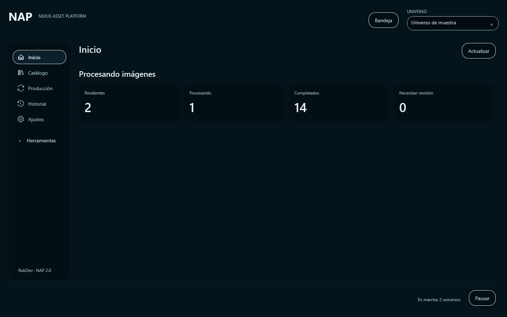
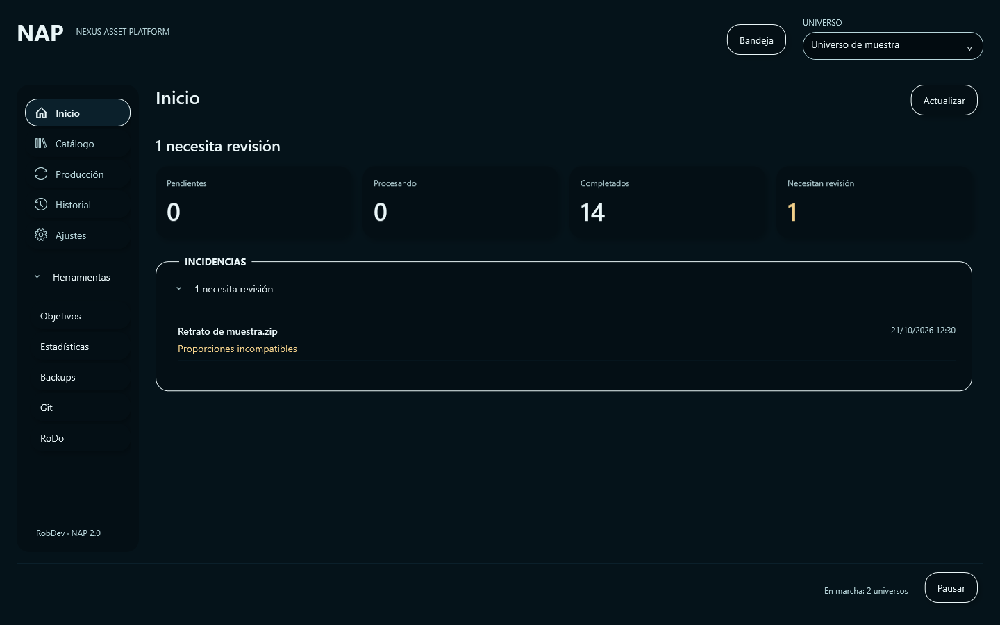
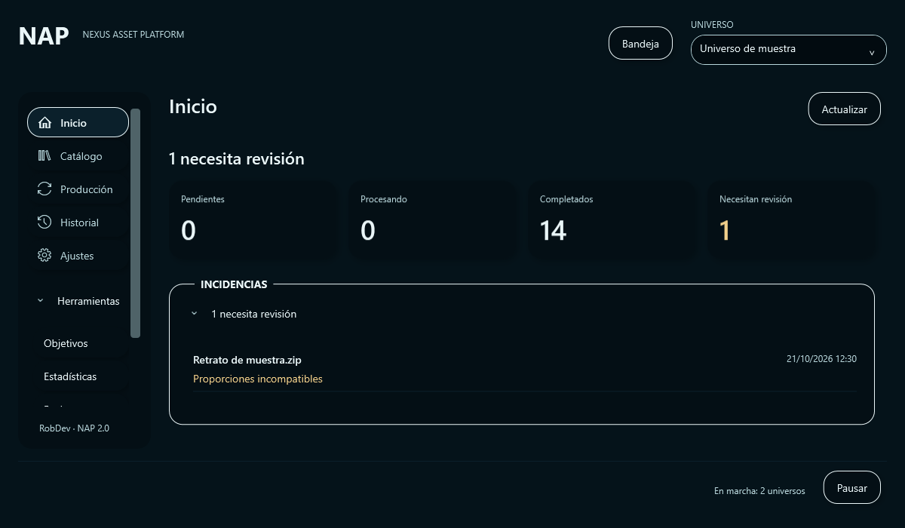

# Revisión visual 1 — P6.1 / P6.2

**Pendiente de aprobación visual y funcional del responsable.** Datos exclusivamente sintéticos. Renderizados del árbol visual WPF del producto, fuera de pantalla, a 1440×900 y 1200×700; no son capturas del MSI. No se ha ejecutado producción.

[Auditoría, contratos, decisiones y límites](../NAP_2_0_FASE_6_REVIEW_1.md) · [Ejecución Windows verificada](https://github.com/robdor80/NAP/actions/runs/39668852346) · [Evidencia y hashes](evidence.json)

## Inicio



## Incidencia y herramientas



## Vista compacta



## Otros estados

- [Automatización pausada](inicio-paused-1440x900.png).
- [Consulta no disponible](inicio-offline-1440x900.png).
- [Arranque local sin conexión al host](inicio-local-1440x900.png).

## Reproducir únicamente la vista previa en Windows

Desde esta rama, con el mecanismo oficial de licencia ya configurado para compilar:

```powershell
dotnet build src/NAP.App/NAP.App.csproj -c Release
& .\src\NAP.App\bin\Release\net8.0-windows\NAP.App.exe --phase6-preview=review --phase6-output="$env:TEMP\nap-phase6-review"
& .\src\NAP.App\bin\Release\net8.0-windows\NAP.App.exe --phase6-preview=review --phase6-output="$env:TEMP\nap-phase6-review" --compact
```

El modo explícito de captura usa adaptadores en memoria sin escritor, guarda PNG y cierra la aplicación. No carga settings del MSI, conecta al host, instala servicios ni crea/procesa ZIP. Los otros modos son `active`, `paused`, `offline` y `local`. Este modo verifica presentación; la aceptación funcional humana es independiente.

La conexión real a AutomationHost sigue limitada al laboratorio explícito de Fase 5. El arranque ordinario y CUTOVER productivo siguen pendientes de #47. #49 continúa abierta con sus reservas originales.
